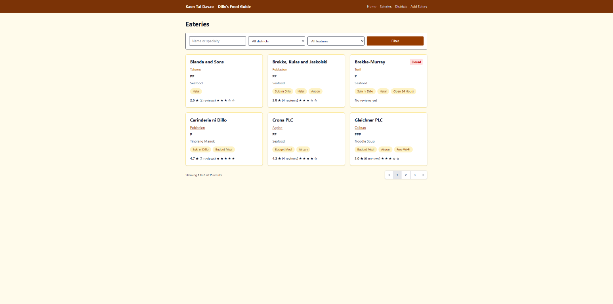
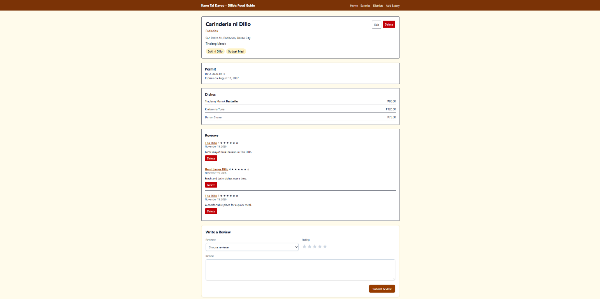
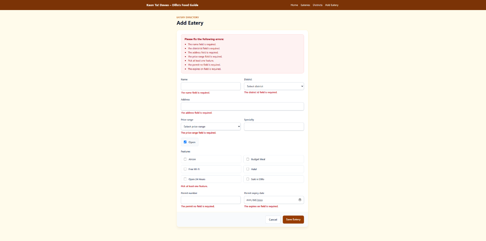

# Kaon Ta! Davao

Henri James Dillo

## Setup

```bash
composer install
cp .env.example .env
php artisan key:generate
touch database/database.sqlite
php artisan migrate:fresh --seed
npm install
npm run build
php artisan serve
```

## Personalized Data

- Extra district: Calinan
- Districts: Poblacion, Talomo, Agdao, Buhangin, Toril, Calinan
- Features: Suki ni Dillo, Budget Meal, Halal, Open 24 Hours, Aircon, Free Wi-Fi
- Primary user: Henri James Dillo - dillo@kaonta.test
- Tita user: Tita Dillo - tita.dillo@kaonta.test
- Password for both users: kaonta2026
- Eatery: Carinderia ni Dillo
- Permit number: DVO-2026-0817
- Permit expiry: August 17, 2027

## Relationships

| Relationship | Type | Why this type fits |
|---|---|---|
| District to Eatery | hasMany and belongsTo | A district has many eateries, and each eatery belongs to one district. |
| Eatery to Dish | hasMany and belongsTo | An eatery has many dishes, and each dish belongs to one eatery. |
| Eatery to Review | hasMany | An eatery can receive many reviews. |
| User to Review | hasMany and belongsTo | A user can write many reviews, and each review belongs to one user. |
| Eatery to Feature | belongsToMany in both directions | An eatery can have many features, and one feature can belong to many eateries. |
| Eatery to Permit | hasOne and belongsTo | An eatery has one permit, and the permit belongs to that eatery. |
| District to Review | hasManyThrough | District reviews are reached through each eatery that belongs to the district. |

## Routes

```text
GET|HEAD / .. home
GET|HEAD districts .. districts.index
GET|HEAD districts/{district} .. districts.show
GET|HEAD eateries .. eateries.index
POST eateries .. eateries.store
GET|HEAD eateries/create .. eateries.create
GET|HEAD eateries/{eatery} .. eateries.show
PUT|PATCH eateries/{eatery} .. eateries.update
DELETE eateries/{eatery} .. eateries.destroy
GET|HEAD eateries/{eatery}/edit .. eateries.edit
POST eateries/{eatery}/reviews .. eateries.reviews.store
GET|HEAD reviewers/{user} .. reviewers.show
DELETE reviews/{review} .. reviews.destroy
```

## Screenshots

### Eatery list



### Eatery page with reviews



### Create form validation errors


